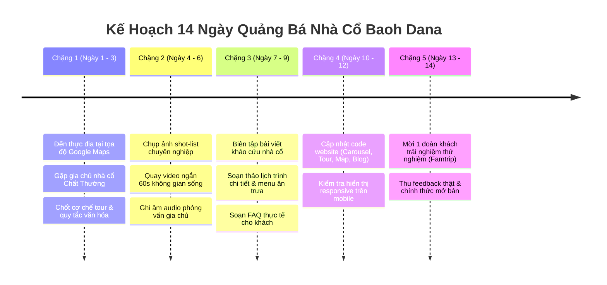

# KẾ HOẠCH CHIẾN DỊCH: TẬP TRUNG XÂY DỰNG & QUẢNG BÁ NHÀ CỔ CHAMPA (BAOH DANA)
**Điểm đến trọng điểm:** Nhà Cổ Chăm - Baoh Dana  
**Vị trí thực địa:** Palei Baoh Dana (Làng Chất Thường), Xã Phước Hậu, Huyện Ninh Phước, Tỉnh Ninh Thuận  
**Tọa độ Google Maps:** [Nhà cổ Chăm - Baoh Dana (11.5844235, 108.9116267)](https://maps.app.goo.gl/FWVdoPUTFZDaNBZW8)  
**Đơn vị thực hiện:** Business Team, Content & Product Team Dana Champa Heritage  

---

## I. TẠI SAO LỰA CHỌN "NHÀ CỔ BAOH DANA" LÀM MŨI NHỌN QUẢNG BÁ ĐẦU TIÊN?

1. **Gắn liền với căn cước thương hiệu "Dana":**  
   Từ "Dana" trong tên thương hiệu ChampaWeb bắt nguồn từ chính địa danh cổ **Palei Baoh Dana** (làng Chất Thường) – một trong những ngôi làng Chăm Ahiêr (Bà-la-môn) cổ kính và nguyên sơ bậc nhất Ninh Thuận, quê hương của cố nhà sử học lừng danh Po Dharma.
2. **Khác biệt hoàn toàn so với du lịch đại trà:**  
   95% khách du lịch đến Ninh Thuận chỉ ghé đền tháp Po Klong Garai hoặc lướt qua xưởng gốm Bàu Trúc rồi về. Chưa có đơn vị nào khai thác sâu **không gian sống mẫu hệ trong nếp nhà cổ Chăm**. Đây là khoảng trống thị trường lớn (Blue Ocean) với giá trị văn hóa độc bản.
3. **Cơ hội "Khử AI hóa" triệt để:**  
   Nhà cổ có con người thật, có chủ nhà, có chén trà vằng, có bếp lửa Thang Ging, có những cột gỗ kê trên tảng đá mát lạnh. Mọi câu chữ viết ra đều gắn liền với xúc giác, thị giác và trải nghiệm trực tiếp của du khách, xóa bỏ hoàn toàn văn phong AI sáo rỗng.

---

## II. GIẢI MÃ KIẾN TRÚC NHÀ CỔ CHAMPA: TƯ LIỆU CỐT LÕI CHO BUSINESS TEAM

Khi viết bài quảng bá hoặc đào tạo hướng dẫn viên, Business team cần nắm vững cấu trúc một khuôn viên nhà cổ truyền thống Chăm. Người Chăm không ở một căn nhà hình ống đơn lẻ, mà sinh hoạt trong **quần thể gia đình mẫu hệ gồm 4 gian nhà chức năng khép kín**:

| Tên gian nhà (Tiếng Chăm) | Tên tiếng Việt | Vị trí & Công năng văn hóa thực tế | Góc khai thác cho khách du lịch |
| :--- | :--- | :--- | :--- |
| **Thang Tôn (Sang Tum)** | Nhà Tổ / Nhà Thiêng | Nằm ở hướng Bắc hoặc Tây của khuôn viên. Nơi tôn nghiêm nhất, dành cho cha mẹ (ông bà ngoại) nghỉ ngơi; nơi lưu giữ gia phả, trang phục nghi lễ Katê, hòm đựng đồ quý của dòng tộc nữ. | Khách đứng trước hiên nghe chủ nhà giải thích vì sao cửa vào Thang Tôn luôn làm thấp (buộc người vào phải cúi đầu tôn kính bậc sinh thành). |
| **Thang Yơ (Sang Yo)** | Nhà Tục / Nhà Đón Rể | Nằm đối diện hoặc liền kề Thang Tôn. Gian phòng riêng dành cho con gái mới lấy chồng (vì người Chăm theo chế độ mẫu hệ, đám cưới thì chàng rể về ở nhà vợ). | Kể câu chuyện phong tục cưới hỏi mẫu hệ Chăm: đồ sính lễ, vai trò trụ cột tinh thần của người phụ nữ trong gia đình. |
| **Thang Ging (Sang Ging)** | Nhà Bếp & Sinh Hoạt | Đặt ở hướng Đông. Trái tim ấm cúng của ngôi nhà. Nơi đặt kiềng 3 chân đỏ lửa, cối giã gạo, hũ mắm nêm, giàn củi khô dự trữ cho mùa mưa bão. | **Điểm nhấn trải nghiệm:** Khách ngồi quây quần uống nước trà lá mát, nếm bánh truyền thống, cùng các Muk nhặt rau, nhóm củi. |
| **Thang Mơng (Sang Mayơng)** | Kho Lúa / Vựa Lương Thực | Đặt riêng biệt tránh ẩm và chuột bọ. Biểu tượng cho sự no ấm sau vụ gặt lúa đồng bằng sông Dinh. | Giới thiệu về nông nghiệp lúa nước truyền thống của Palei Baoh Dana và hệ thống thủy lợi đập Nha Trinh. |

### Các chi tiết kiến trúc độc bản cần nhấn mạnh:
- **Cột gỗ kê đá tảng (Kanieng pơh):** Các cột nhà bằng gỗ lim, gỗ sến cổ thụ không chôn xuống đất mà kê trên các phiến đá tảng tròn nhẵn để chống mối mọt và hơi ẩm xứ cát.
- **Vách đất trộn rơm (Tanaow paba):** Khung sườn tre trát bùn đất sét trộn rơm mục, mùa hè bước vào phòng mát hơn nhiệt độ ngoài trời 5 - 6°C, mùa gió bấc thì chắn gió cực tốt.
- **Vì kèo mộng gỗ:** Toàn bộ liên kết mộng bằng nêm gỗ rừng, không dùng một chiếc đinh sắt hiện đại nào.

---

## III. GÓI TOUR ĐẶC TRƯNG (SIGNATURE TOUR): "MỘT NGÀY DƯỚI MÁI NHÀ CỔ BAOH DANA"

Business team dùng khung sản phẩm này để đưa trực tiếp lên mục Tour của Website:

### 1. Thông tin nhanh
- **Tên tour:** Trầm tích Baoh Dana: Nửa ngày sống cùng gia đình Chăm trong nếp nhà cổ mẫu hệ
- **Thời lượng:** 4.5 tiếng (Khung giờ sáng: 08:00 - 12:30 HOẶC Khung giờ chiều: 14:00 - 18:30)
- **Địa điểm:** Làng Chất Thường (Palei Baoh Dana), Phước Hậu, Ninh Phước (cách trung tâm Phan Rang 9km)
- **Quy mô:** Nhóm nhỏ tối đa 6 - 8 khách (để không làm xáo trộn không gian yên tĩnh của ngôi nhà)
- **Giá dự kiến:** 490.000đ/người lớn • 320.000đ/trẻ em

### 2. Timeline trải nghiệm thực tế (Không văn mẫu)
- **08:00 - 08:30 | Lối vào bóng râm làng cổ:**  
  Xe đón tại Phan Rang, chạy qua những con đường làng rợp bóng cây trôm và nương lúa Chất Thường. Đi bộ vào ngõ nhỏ của ngôi nhà cổ Baoh Dana.
- **08:30 - 09:30 | Trà vằng bậu cửa & Câu chuyện 4 gian nhà:**  
  Chủ nhà đón khách bằng câu chào *"Hamu tanran"*, mời ngụm trà lá vằng ủ trong chum sành mát lịm. Ngồi trên bậu cửa gỗ nghe gia chủ phân biệt Thang Tôn, Thang Yơ, Thang Ging; ngắm cách người xưa dựng cột gỗ trên đá tảng.
- **09:30 - 10:45 | Trải nghiệm nếp sống thường nhật:**  
  - Tự tay cầm chày gỗ thử nhịp giã gạo trên cối đá cổ.
  - Cùng Muk gói một mẻ bánh nén hoặc nướng bánh gừng trên than hồng hiên bếp Thang Ging.
  - Học viết tên mình bằng nét chữ Akhar Thrah truyền thống trên giấy bổi thủ công.
- **10:45 - 12:00 | Bữa cơm mẫu hệ chuẩn vị gia đình Chăm:**  
  Dùng bữa trưa thân mật nấu bằng nồi đất Bàu Trúc:
  - Canh bồi rau tập tàng nấu cá đồng.
  - Cá nục kho nghệ tươi xứ cát cuốn bánh tráng mè.
  - Rau rừng luộc chấm mắm nêm gia truyền.
  - Tráng miệng: Chuối già hương và chè đậu xanh cốt dừa.
- **12:00 - 12:30 | Nghỉ trưa & Tạm biệt:**  
  Ngả lưng trên võng gai hoặc ghế dài dưới tán cây râm mát, cảm nhận làn gió đồng bằng trước khi xe đưa về khách sạn.

---

## IV. BẢNG PHÂN BỔ NỘI DUNG NHÀ CỔ VÀO CÁC SECTION TRÊN WEBSITE

Business và Content team thực hiện phân phối nội dung vào hệ thống website như sau:

| Section trên Web | File Code tương ứng | Đầu việc cụ thể cần thực hiện |
| :--- | :--- | :--- |
| **Top Carousel Banner** | `DanaLifeCarousel.tsx` | Đưa bộ 3 slide ảnh chụp thực tế tại Nhà Cổ Baoh Dana lên đầu slide:  1. *Góc hiên Thang Ging rọi nắng sớm* 2. *Chi tiết chân cột gỗ kê đá tảng trăm năm* 3. *Khoảnh khắc gia đình Chăm quây quần bên ấm trà vằng*. |
| **Hero Section** | `HeroSection.tsx` | Cập nhật Tagline phụ: *"Khám phá không gian sống nguyên bản tại Nhà Cổ Baoh Dana cùng người bản xứ"*. Thêm nút CTA: *"Xem trải nghiệm Nhà Cổ"*. |
| **Triết lý Dana** | `ManifestoSection.tsx` | Nhấn mạnh triết lý: Di sản Champa không chỉ có đền tháp của vua chúa, mà cốt lõi nằm ở nếp nhà, góc bếp và lời ru của những người Mẹ trong ngôi nhà cổ. |
| **Danh sách Tour** | `champaData.ts` (`TOURS`) | Đưa tour *"Trầm tích Baoh Dana: Nửa ngày dưới nếp nhà cổ mẫu hệ"* lên vị trí ưu tiên số 1 trên trang chủ và trang `TourListPage.tsx`. |
| **Bản đồ Điểm dừng** | `champaData.ts` (`WAYPOINTS`) | Bổ sung Trạm **Palei Baoh Dana (Làng Chất Thường)** trên bản đồ tuyến khảo cổ, gắn link chỉ đường Google Maps: `https://maps.app.goo.gl/FWVdoPUTFZDaNBZW8`. |
| **Chuyên mục Blog** | `blogData.ts` & `blogDetailData.ts` | Xuất bản bài khảo cứu thực nghiệm độc quyền: *"Đi tìm nếp nhà cổ Champa ở Palei Baoh Dana: Bí mật kiến trúc cột gỗ kê đá chống chọi gió cát sa mạc"*. |
| **Di sản số / Ngôn ngữ** | `languageData.ts` | Bổ sung bộ từ vựng chủ đề "Ngôi nhà & Gia đình": *Sang* (Nhà), *Thang Tôn* (Nhà tổ), *Thang Ging* (Nhà bếp), *Ama* (Cha), *Amư* (Mẹ), *Anak* (Con). |

---

## V. CHECKLIST CÔNG VIỆC THỰC ĐỊA CHO BUSINESS TEAM TẠI TOẠ ĐỘ BAOH DANA

Để hoàn tất tư liệu trước ngày lên bài, Business team cử nhân sự đến tận nơi tại [Google Maps Baoh Dana](https://maps.app.goo.gl/FWVdoPUTFZDaNBZW8) thực hiện các đầu việc:

### 1. Khảo sát & Ký kết hợp tác với chủ nhà cổ
- [ ] Gặp gỡ đại diện gia đình/chủ nhân ngôi nhà cổ tại làng Chất Thường.
- [ ] Thống nhất cơ chế đón tiếp: Mỗi tuần đón tối đa bao nhiêu đoàn, khung giờ tiếp khách để không ảnh hưởng đời sống riêng.
- [ ] Thỏa thuận chi phí hỗ trợ gia đình (tiền tiếp khách, chuẩn bị trà bánh, tiền công nấu bữa cơm Chăm).
- [ ] Quy định khu vực khách được tham quan và khu vực riêng tư của gia đình (đặc biệt là bàn thờ gian Thang Tôn).

### 2. Danh mục hình ảnh/video cần thu thập (Shot-list)
- [ ] **Góc rộng (Wide):** Toàn cảnh khuôn viên sân vườn, cây ăn trái và thế đất 4 gian nhà.
- [ ] **Trung cảnh (Medium):** Mái ngói rêu phong, hiên nhà Thang Ging, bậu cửa gỗ nơi gia chủ ngồi tiếp khách.
- [ ] **Cận cảnh đặc tả (Macro/Detail):**
  - Khối đá tảng tròn đỡ chân cột gỗ lim.
  - Mộng nêm gỗ liên kết rui mè không đinh.
  - Vách đất trát rơm lộ rõ từng sợi rơm khô tự nhiên.
  - Hũ sành, niêu đất nung và ấm trà ủ khói bếp.
- [ ] **Khoảnh khắc con người (Human):** Bàn tay Muk têm trầu, nụ cười hiền hậu của chủ nhà khi rót nước mời khách, cảnh cả nhà ngồi ăn cơm trên manh chiếu cói.

### 3. Phỏng vấn gia chủ ghi âm tư liệu
- [ ] Ngôi nhà này dựng từ thời ông bà nào? Ước tính khoảng bao nhiêu năm tuổi?
- [ ] Cột gỗ này là gỗ gì? Khi xưa chở từ rừng nào về đây?
- [ ] Tại sao nhà Chăm ngày xưa không làm nhiều cửa sổ to mà chỉ làm cửa chính thấp?
- [ ] Trong các ngày lễ hội Katê hay Tết Ramuwan, con cháu tề tựu về gian Thang Tôn làm lễ cúng tổ tiên như thế nào?

---

## VI. BẢNG MẪU VIẾT LẠI COPY TRANG WEB (DE-AI WRITING EXAMPLES)

Business Team copy trực tiếp các đoạn văn mẫu dưới đây để đưa lên web:

### 1. Đoạn mô tả Card Tour trên Trang chủ
> **Trầm tích Baoh Dana: Nửa ngày dưới nếp nhà cổ mẫu hệ Chăm**  
> *"Rời xa những tour check-in ồn ào, Dana đưa bạn rẽ vào con ngõ rợp bóng cây của làng Chất Thường để bước chân vào nếp nhà cổ trăm năm tuổi. Tại đây, bạn sẽ ngồi bậu cửa uống ngụm trà lá vằng ấm nồng, nghe gia chủ giải thích triết lý dựng cột gỗ kê đá tảng, tự tay cầm chày giã cối gạo xưa và thưởng thức mâm cơm gia đình người Chăm chuẩn vị bên gian bếp Thang Ging."*  
> • **Trải nghiệm:** Uống trà vằng • Khám phá 4 gian nhà mẫu hệ • Bữa trưa mâm cơm gia đình Chăm  
> • **Thời lượng:** 4.5 giờ • Nhóm nhỏ 4 - 8 khách

### 2. Đoạn giới thiệu trên bản đồ Waypoints
> **Trạm Văn Hóa: Nhà Cổ Chăm - Palei Baoh Dana**  
> *"Nằm cách tháp Po Klong Garai chỉ 4.5km về hướng Tây Nam, làng cổ Baoh Dana (Chất Thường) lưu giữ những cụm nhà mẫu hệ truyền thống hiếm hoi còn nguyên vẹn tại Ninh Thuận. Nơi đây phản ánh trọn vẹn nếp sống kính trên nhường dưới, tinh thần nương tựa đất mẹ và kỹ nghệ dựng nhà mộc không dùng đinh sắt của tiền nhân."*  
> • **Tọa độ:** Thôn Chất Thường, xã Phước Hậu, Ninh Phước  
> • **Chỉ dẫn:** Đường ô tô vào tận cổng làng, rẽ vào hẻm đất 80m. Nên ghé lúc 8:30 sáng hoặc 15:00 chiều.

---

## VII. LỊCH TRÌNH THỰC HIỆN CHIẾN DỊCH (TIMELINE 14 NGÀY)

---

## VIII. CAM KẾT VĂN HÓA & TRÁCH NHIỆM BẢN ĐỊA (CULTURAL ETHICS)
1. **Không can thiệp vào đời sống tâm linh:** Gian Thang Tôn chỉ tham quan từ bên ngoài hiên, tuyệt đối không di chuyển bất kỳ đồ tế tự nào nếu không có sự cho phép của chủ nhà.
2. **Bảo tồn nguyên trạng:** Tuyệt đối không yêu cầu chủ nhà sơn phết hay sửa đổi cấu trúc gỗ cũ để "chụp ảnh cho đẹp". Vẻ đẹp của Baoh Dana là sự phong rêu của thời gian.
3. **Thu nhập công bằng:** 60% giá trị thu từ tour trải nghiệm nhà cổ được chuyển giao trực tiếp cho gia đình chủ nhà và người hỗ trợ chuẩn bị bữa ăn tại làng.
