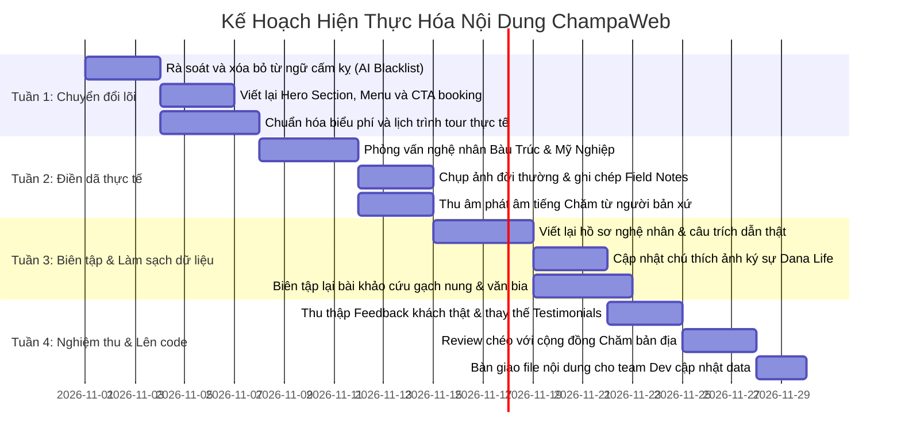

# KẾ HOẠCH HÀNH ĐỘNG KHỬ "AI HÓA" NỘI DUNG & THỰC ĐỊA HÓA CÁC SECTION
**Dự án:** ChampaWeb (Dana Champa Heritage)  
**Đối tượng thực hiện:** Bộ phận Business, Marketing & Đội ngũ Phát triển Sản phẩm Tour  
**Mục tiêu cốt lõi:** Thay thế toàn bộ ngôn từ sáo rỗng, khoa trương kiểu AI bằng tiếng nói thực tế của con người bản địa, trải nghiệm điền dã thực chứng và thông tin thương mại minh bạch.

---

## I. TỔNG QUAN VẤN ĐỀ: "MÙI AI" TRÊN WEBSITE HIỆN TẠI

### 1. Triệu chứng nhận diện
- **Lạm dụng sáo ngữ & mỹ từ khoa trương:** Các cụm từ lặp đi lặp lại như *"lời kinh nguyện vĩnh cửu"*, *"huyền bí ngàn năm"*, *"chữa lành ký ức"*, *"tiếp nối hồn thiêng"*, *"tế bào của thân thể thần linh"*, *"nguyên khối thách thức thời gian"*.
- **Thiếu thực tế vận hành tour:** Khách đọc xong không biết đi mấy giờ, ăn món gì, mang giày gì, trời nắng bao nhiêu độ, trẻ em đi được không, tiền vé thực sự chia cho ai.
- **Review và nhân vật mang tính giả lập:** Đánh giá của khách hàng bóng bẩy như văn mẫu chấm thi, thiếu chi tiết đời thường; trích dẫn nghệ nhân nói như giáo sư ngôn ngữ học thay vì ngôn ngữ mộc mạc của các Muk, các Chú ở làng.
- **Tính học thuật nửa vời:** Đưa các giả thuyết nghiên cứu nhưng viết giọng văn kịch tính hóa thay vì khách quan, khoa học.

### 2. Định vị phong cách mới: "Thực Địa - Bản Địa - Minh Bạch"
- **Thực địa (Fieldwork-driven):** Mỗi thông tin viết ra phải bắt nguồn từ bước chân đi thực tế, có địa chỉ cụ thể, thời gian rõ ràng, quan sát mắt thấy tai nghe.
- **Bản địa (Indigenous voice):** Giữ gìn sự mộc mạc, tôn trọng văn hóa Chăm Panduranga, trích dẫn đúng giọng điệu của bà con địa phương.
- **Minh bạch (Commercial clarity):** Thông tin tour rõ ràng, giá tiền, dịch vụ bao gồm, đóng góp cộng đồng thể hiện bằng cơ chế cụ thể chứ không dừng ở khẩu hiệu.

> 🔴 **CHIẾN DỊCH TIÊU ĐIỂM ƯU TIÊN SỐ 1 THEO BUSINESS TEAM:**  
> Toàn bộ đội ngũ tập trung nguồn lực xây dựng & quảng bá sản phẩm **Nhà Cổ Chăm - Baoh Dana** (Làng Chất Thường, Phước Hậu, Ninh Phước - [Xem vị trí Google Maps](https://maps.app.goo.gl/FWVdoPUTFZDaNBZW8)).  
> 👉 Xem kế hoạch hành động riêng biệt tại: [KE_HOACH_CHIEN_DICH_NHA_CO_BAOH_DANA.md](file:///d:/clone/ChampaWeb/KE_HOACH_CHIEN_DICH_NHA_CO_BAOH_DANA.md)

---

## II. BỘ QUY CHUẨN TONE OF VOICE (TOV) CHO BUSINESS TEAM

| Tiêu chí | ❌ BỎ NGAY (Văn phong AI sáo rỗng) | ✅ THAY BẰNG (Thực tế & Bản địa) |
| :--- | :--- | :--- |
| **Góc nhìn** | Giọng nói đấng sáng tạo vô hình, triết lý mơ hồ, tán dương thái quá. | Lời kể của người làm tour tận tâm, người bản xứ dẫn đường, du khách trải nghiệm thật. |
| **Từ ngữ miêu tả** | *Kỳ vĩ, huyền bí, vĩnh cửu, thiêng liêng, đắm say, ngất ngây, bản hòa ca...* | Mô tả bằng giác quan: *mùi rơm cháy, đất sét mịn dẻo ven sông Quao, sắc gạch cam trầm, nhịp gõ kèn Saranai...* |
| **Số liệu & Tác động** | *"100% linh hồn bản địa", "Hoàn lưu tối đa"...* | Con số rõ ràng: *650.000đ/tour, trong đó 200.000đ gửi trực tiếp nghệ nhân, 50.000đ vào quỹ dạy chữ Akhar Thrah của làng.* |
| **Trích dẫn nhân vật** | Lời thoại bóng bẩy, triết lý hàn lâm do AI bịa. | Trích nguyên văn cách xưng hô mộc mạc: *"Cái đất này phải lấy lúc sáng sớm ở bờ sông Quao, để khô ba nắng rồi mới giã..."* |
| **Mô tả điểm đến** | *"Ngọn tháp sừng sững như ngọn lửa thiêng không bao giờ tắt..."* | *"Tháp Po Klong Garai nằm trên đồi Trầu, leo 87 bậc đá. Nên ghé lúc 6:30 sáng khi nắng chưa gắt và vắng bóng đoàn đông."* |

---

## III. MA TRẬN ĐẦU VIỆC CHI TIẾT THEO TỪNG SECTION

### 1. Trang Chủ (`DanaHome.tsx`)

#### 1.1. Hero Section & Bộ Tìm Kiếm Tour (`HeroSection.tsx`)
- **Hiện trạng:** Tagline chung chung, thanh tìm kiếm chưa tạo được cảm giác tin cậy thực tế.
- **Đầu việc cần làm:**
  - [ ] **Viết lại Headline & Subheadline:** Tập trung vào giá trị độc bản: Tour văn hóa trải nghiệm có nghệ nhân bản địa dẫn đường trực tiếp, lịch trình hạn chế tối đa tính thương mại xô bồ.
  - [ ] **Tối ưu Micro-copy ô tìm kiếm:** Thay nhãn chung chung bằng gợi ý thiết thực: *"Bạn đi bao nhiêu người?", "Điểm muốn ghé: Làng gốm Bàu Trúc / Đền tháp / Làng dệt?", "Thời gian: Sáng sớm / Hoàng hôn"*.
  - [ ] **Bổ sung cam kết thực tế:** Thêm dòng cam kết ngắn: *Nhóm nhỏ dưới 10 khách • 100% hướng dẫn viên là con em người Chăm • Không ép mua sắm*.

#### 1.2. Banner Slider Ký Sự Ảnh Thực Địa (`DanaLifeCarousel.tsx`)
- **Hiện trạng:** Caption ảnh hoa mỹ kiểu văn tế: *"Nắng Sớm Trút Đầy Ngõ Làng Đất Nung"*, *"Nụ Cười Trầm Tích Của Vùng Đất Panduranga"*.
- **Đầu việc cần làm:**
  - [ ] **Đổi cấu trúc chú thích ảnh sang chuẩn "Ký sự điền dã" (Field Notes):**
    - **Thời điểm & Địa điểm thực:** Ghi rõ góc chụp (Ví dụ: *Xóm 3, Làng Bàu Trúc, 06:45 AM*).
    - **Câu chuyện hậu trường:** Thay vì bình phẩm trừu tượng, hãy kể lại khoảnh khắc chụp: *"Muk Thuận đang chuẩn bị đợt nung lộ thiên cuối tuần. Bà bảo đợt này nung 40 chiếc bình cho đơn hàng của homestay ngoài Phan Rang."*
    - **Tác giả ảnh:** Ghi tên nhiếp ảnh gia / thành viên nhóm điền dã thực tế.

#### 1.3. Triết Lý & Tác Động Xã Hội (`ManifestoSection.tsx`)
- **Hiện trạng:** Tuyên ngôn *"Chữa lành ký ức, tiếp nối hồn thiêng"* nghe nặng màu sắc tiếp thị tâm linh; các con số 100%, 70% chưa có bằng chứng thuyết phục.
- **Đầu việc cần làm:**
  - [ ] **Viết lại đoạn triết lý thương hiệu:** Định vị Dana là cầu nối du lịch trách nhiệm. Chúng tôi không làm "du lịch ngắm nghía cưỡi ngựa xem hoa", mà tạo thu nhập bền vững cho nghệ nhân giữ nghề.
  - [ ] **Minh chứng hóa 4 chỉ số tác động:**
    - `100% Nghệ nhân bản địa`: Ghi rõ danh sách 12 nghệ nhân đối tác tại Bàu Trúc và Mỹ Nghiệp.
    - `02 Làng cổ`: Nêu rõ tình trạng thực tế làng gốm Bàu Trúc và làng dệt Mỹ Nghiệp đang cần hỗ trợ gì.
    - `UNESCO`: Nêu cụ thể danh hiệu UNESCO ghi danh năm nào (Tháng 11/2022) và nỗ lực bảo tồn thực tế của Dana.
    - `70% Hoàn lưu`: Minh bạch công thức phân bổ doanh thu tour (Bao nhiêu % trả nghệ nhân đứng lớp, bao nhiêu % mua nguyên liệu đất/rơm/sợi, bao nhiêu % trích quỹ lớp học Akhar Thrah).

#### 1.4. Danh Mục Tour Trải Nghiệm (`ToursSection.tsx` & `TourListPage.tsx`)
- **Hiện trạng:** Tên tour và mô tả sặc mùi quảng cáo hư cấu (*Ký ức Bàu Trúc: Đất sét, Lửa & Bàn tay Người Mẹ*).
- **Đầu việc cần làm:**
  - [ ] **Viết lại tiêu đề tour rõ ràng, hấp dẫn:** Giữ tính văn hóa nhưng dễ hiểu (Ví dụ: *Học làm gốm không bàn xoay cùng Muk Phan & Trải nghiệm nung lộ thiên lúc hoàng hôn*).
  - [ ] **Đoạn mô tả ngắn (Card Description):** Nêu bật 3 giá trị thiết thực: Bạn sẽ tự tay làm cái gì mang về? Ăn trưa món gì? Gặp ai?
  - [ ] **Cập nhật Chip thông tin thực dụng:** Thay chip sáo rỗng bằng: *Nhóm 4 - 8 khách*, *Thời lượng: 4.5 tiếng*, *Đã gồm nước mát & đồ ăn nhẹ bản địa*.

#### 1.5. Tuyến Khảo Cổ & Bản Đồ Điểm Dừng (`WaypointsSection.tsx`)
- **Hiện trạng:** Điểm dừng chỉ có mô tả chung chung, thiếu cẩm nang di chuyển.
- **Đầu việc cần làm:**
  - [ ] **Bổ sung Practical Tips (Mẹo thực tế):**
    - Điểm đền tháp: Cần mặc áo có tay, váy/quần qua đầu gối; bậc tam cấp dốc đứng, người lớn tuổi nên dùng gậy.
    - Thời gian ghé thăm lý tưởng nhất trong ngày để tránh nắng 38-40°C của Ninh Thuận.
    - Tuyến đường di chuyển: Đi xe máy hay ô tô 16 chỗ vào được tận nơi.

#### 1.6. Chân Dung Nghệ Nhân Bản Địa (`ArtisansSection.tsx`)
- **Hiện trạng:** Viết như tiểu sử nhân vật giả tưởng, thiếu cá tính riêng biệt.
- **Đầu việc cần làm:**
  - [ ] **Thực hiện phỏng vấn 1-1 với ít nhất 3 nghệ nhân thật:**
    - Nghệ nhân Đàng Thị Phan (Làng gốm Bàu Trúc) hoặc nghệ nhân tương đương.
    - Nghệ nhân dệt Thuận Thị Trụ / nghệ nhân trẻ tại Mỹ Nghiệp.
    - Chức sắc hoặc người am hiểu phong tục lễ hội Katê / Ramuwan.
  - [ ] **Nội dung cần có trong mỗi hồ sơ nghệ nhân:**
    - Tuổi nghề thực tế và thói quen làm việc hàng ngày.
    - Câu nói nguyên văn (bằng tiếng Chăm phiên âm + dịch nghĩa tiếng Việt giản dị).
    - Nỗi lo thực tế: Giới trẻ bỏ nghề đi làm công nhân, thiếu đất sét mịn, thị trường tiêu thụ khó khăn.
    - Vai trò của họ trong tour Dana: Họ trực tiếp hướng dẫn du khách điều gì?

#### 1.7. Đánh Giá Khách Hàng Thực Chứng (`TestimonialsSection.tsx`)
- **Hiện trạng:** Review văn mẫu AI với những câu cảm thán sáo rỗng (*"Chuyến đi chữa lành nhất đời tôi...", 5/5 sao*).
- **Đầu việc cần làm:**
  - [ ] **Thu thập 5-8 feedback thật từ du khách đã đi Ninh Thuận:**
    - Tên thật, nghề nghiệp, thành phố (Ví dụ: *Nguyễn Hoàng My - Kiến trúc sư cảnh quan, TP.HCM*).
    - Trải nghiệm cụ thể: Đi vào tháng mấy, ấn tượng nhất chi tiết nào (món cá nướng cuốn bánh tráng, ngụm trà hạt é của Muk, cảm giác đất sét dính tay khó rửa nhưng vui...).
    - Lời khuyên thật lòng cho người đi sau (Nắng lắm nhớ mang mũ rộng vành, nên học trước vài câu chào tiếng Chăm).
    - Đính kèm ảnh check-in thật của khách (ảnh không filter quá đà).

---

### 2. Trang Chi Tiết Tour (`TourDetailPage.tsx`)

Đây là trang quyết định hành vi đặt tour (Conversion Page), đòi hỏi tính xác thực cao nhất.

- **Đầu việc cần làm:**
  - [ ] **Chi tiết hóa Lịch trình (Timeline Itinerary):**
    - 07:30: Đón tại khách sạn trung tâm Phan Rang.
    - 08:00 - 09:30: Lên tháp Po Klong Garai khi nắng xiên; nghe hướng dẫn viên phân tích cấu trúc gạch nung và trích đoạn văn bia cổ.
    - 10:00 - 11:30: Về xưởng gốm tại Bàu Trúc; ngồi ghế con cùng nghệ nhân, nhào đất và tự nặn 1 sản phẩm mộc.
    - 12:00: Dùng bữa trưa mâm cơm gia đình người Chăm (Nêu rõ món ăn: canh bồi, gỏi lá dong, cá kho khô...).
  - [ ] **Chính sách & Chi phí rõ ràng:**
    - Ghi cụ thể: Giá vé đã bao gồm vé thắng cảnh, tiền bồi dưỡng nghệ nhân, bảo hiểm du lịch, nước suối.
    - Không bao gồm: Chi phí gửi xe cá nhân, tiền tip tự nguyện nếu khách quý nghệ nhân, đóng gói ship sản phẩm gốm về nhà qua bưu điện.
  - [ ] **Bộ Quy Tắc Văn Hóa Ứng Xử (Do's & Don'ts):**
    - Không trèo lên bệ thờ Yoni - Linga để chụp ảnh.
    - Không chạm tay vào hoa văn gạch đang trong quá trình phong hóa.
    - Xin phép trước khi chụp ảnh chân dung người già và trẻ nhỏ trong làng.
  - [ ] **Phần FAQ (Câu hỏi thường gặp thực tế):**
    - *"Trời mưa tour có đi được không?"* (Mùa mưa Bàu Trúc nung gốm ra sao?)
    - *"Sản phẩm gốm nặn xong có mang về ngay được không?"* (Giải thích: gốm cần phơi khô 2 ngày và nung 1 ngày; hỗ trợ nung và ship bưu điện tận nhà sau).
    - *"Người ăn chay có món ăn trưa phù hợp không?"*

---

### 3. Trang Blog & Khảo Cứu (`BlogPage.tsx` & `BlogDetailPage.tsx`)

- **Hiện trạng:** Bài viết dài nhưng sa đà vào miêu tả thần thoại viển vông, tự xưng *"Hội đồng Chuyên môn Văn hóa Dana"* thiếu tính khách quan.
- **Đầu việc cần làm:**
  - [ ] **Rà soát lại danh mục tác giả & nguồn trích dẫn:**
    - Ghi rõ nguồn tư liệu lịch sử: Công trình của Viện Viễn Đông Bác Cổ (EFEO), nhà nghiên cứu Sakaya, GS. Lương Nhiệm Hiện, TS. Bá Trung Phụ.
    - Ghi rõ người dẫn thực địa: Hướng dẫn viên cộng đồng địa phương.
  - [ ] **Cấu trúc lại bài viết khảo cứu theo định dạng "Điền dã & Thực nghiệm":**
    - **Phần 1 - Bối cảnh & Hiện trạng di tích ngày nay:** Thực trạng bảo tồn, khách đến thăm nhìn thấy gì.
    - **Phần 2 - Lời kể của người trong cuộc:** Phỏng vấn người giữ tháp, nghệ nhân lớn tuổi.
    - **Phần 3 - Phân tích khoa học/kỹ thuật:** Giải thích cơ chế mài chập, chất keo bời lời bằng ngôn ngữ đại chúng dễ hiểu, không thần thánh hóa.
    - **Phần 4 - Hướng dẫn trải nghiệm cho du khách:** Đến đây ngắm góc nào đẹp nhất, cách trân trọng di sản.

---

### 4. Trang Di Sản Số & Ngôn Ngữ Chăm (`DigitalHeritagePage.tsx`)

- **Hiện trạng:** Bảng chữ Akhar Thrah và từ vựng còn mang tính học thuật thô, du khách không biết dùng vào đâu.
- **Đầu việc cần làm:**
  - [ ] **Chuyển đổi từ vựng sang dạng "Cẩm nang giao tiếp khi vào làng Chăm":**
    - Lời chào hỏi lịch sự: *Hamu tanran* (Xin chào), *Sukur* (Cảm ơn), *Kao hơm* (Tôi thích/tôi quý).
    - Cách gọi tên người lớn tuổi: *Muk* (Bà/Mẹ lớn tuổi), *Ong* (Ông), *Ayơ* (Anh/Chị).
  - [ ] **Chuẩn hóa tệp thu âm phát âm (Audio Clips):**
    - Mời người bản xứ Chăm (giọng chuẩn vùng Ninh Phước) thu âm từng từ đơn và câu giao tiếp ngắn, thời lượng 2-3 giây/file, phát âm tự nhiên, ấm áp.
  - [ ] **Giải nghĩa văn bia & hiện vật cổ:**
    - Bỏ các lời dịch AI kỳ dị, thay bằng bản tóm tắt nội dung nhân văn: Lời dặn con cháu đắp đập ngăn mặn dẫn thủy nhập điền, tri ân mẹ xứ sở Poh Nagar...

---

## IV. BỘ CÂU HỎI ĐIỀN DÃ (FIELDWORK INTERVIEW SCRIPTS)

Để business team đi thực tế thu thập chất liệu chân thật mà không cần tự bịa nội dung:

### 1. Phỏng vấn nghệ nhân Làng Gốm Bàu Trúc
1. *"Muk làm nghề này từ năm mấy tuổi? Hồi nhỏ ai là người truyền lại cho Muk?"*
2. *"Công đoạn nào cực nhất và dễ hư nhất trong lúc làm một cái bình gốm?"*
3. *"Tại sao gốm Bàu Trúc không dùng bàn xoay mà người phụ nữ phải đi giật lùi quanh khối đất? Đi một ngày như vậy khoảng bao nhiêu vòng?"*
4. *"Lúc nung bằng rơm với củi ngoài trời, làm sao Muk biết lửa đã đủ độ chín mà không có đồng hồ đo nhiệt?"*
5. *"Khách du lịch đến đây làm Muk vui nhất điều gì và có điều gì họ làm khiến Muk thấy tiếc cho gốm không?"*

### 2. Phỏng vấn nghệ nhân Dệt Thổ Cẩm Mỹ Nghiệp
1. *"Những màu đỏ, đen, vàng trên tấm vải này nhuộm từ cây gì trong vườn hay trên rừng?"*
2. *"Hoa văn con rồng Makara hay mắt chuồn chuồn này có ý nghĩa gì trong đời sống gia đình người Chăm?"*
3. *"Mất bao nhiêu ngày để dệt xong một tấm khăn choàng hoàn chỉnh?"*
4. *"Muk muốn nhắn nhủ điều gì nhất với những bạn trẻ lần đầu cầm vào sợi chỉ dệt của làng mình?"*

### 3. Phỏng vấn du khách sau tour (Post-tour Feedback Form)
1. *"Điều gì trong tour khiến bạn bất ngờ nhất so với những gì bạn từng đọc trên mạng?"*
2. *"Món ăn hoặc khoảnh khắc nào cùng nghệ nhân làm bạn nhớ nhất?"*
3. *"Có điểm nào về thời tiết, di chuyển hoặc thời gian làm bạn thấy mệt hay cần chuẩn bị kỹ hơn không?"*
4. *"Nếu giới thiệu cho một người bạn thân đi tour này, bạn sẽ dặn họ mang theo món đồ gì?"*

---

## V. VÍ DỤ ĐỐI CHIẾU THỰC TẾ: BEFORE VS. AFTER

### Ví dụ 1: Mô tả Tour Gốm Bàu Trúc
- **❌ Trước đây (Văn AI):**  
  > *"Ký ức Bàu Trúc: Đất sét, Lửa & Bàn tay Người Mẹ. Thực hành phương thức “tay làm chân quay” độc nhất vô nhị. Cùng Muk Phan nhóm đống rơm nung gốm lộ thiên lúc chạng vạng và thưởng thức ngụm nước chè vằng truyền thống giữa bản hòa ca đất trời."*
- **✅ Sau khi viết lại (Thực tế & Rõ ràng):**  
  > **Tour Nửa Ngày: Cùng Muk Thuận nặn gốm không bàn xoay & Chờ mẻ nung rơm hoàng hôn**  
  > *"Tại xóm 3 làng Bàu Trúc, bạn sẽ ngồi trên chiếc đôn gỗ nhỏ, nghe Muk Thuận chỉ cách dùng mu bàn tay ép thớ đất sông Quao và đi giật lùi theo nhịp nặn gốm cổ truyền.  
  > • Tự tay làm: 1 chiếc chén hoặc bình mộc theo ý thích (xưởng hỗ trợ nung và bọc xốp gửi bưu điện về tận nhà).  
  > • Thưởng thức: Nước lá vằng ủ ấm và bánh gừng truyền thống dưới hiên nhà Chăm.  
  > • Thời gian: 14:30 - 18:00 (đón hoàng hôn lúc nhóm lửa nung gốm ngoài sân bãi)."*

---

### Ví dụ 2: Lời giới thiệu Tháp Po Klong Garai
- **❌ Trước đây (Văn AI):**  
  > *"Bí ẩn gạch nung không vữa mạch Po Klong Garai: Khi lửa và đất hóa thành lời kinh nguyện vĩnh cửu. Ngọn tháp sừng sững như ngọn lửa thiêng không bao giờ tắt trên đỉnh đồi Trầu qua tám thế kỷ thăng trầm gió cát..."*
- **✅ Sau khi viết lại (Góc nhìn di sản thực tế):**  
  > **Tháp Po Klong Garai: Dấu ấn kỹ nghệ gạch nung thế kỷ XIII trên Đồi Trầu**  
  > *"Đứng dưới chân cụm tháp Kalan xây từ thời vua Chế Mân, điều khiến bạn kinh ngạc không phải là những câu chuyện huyền bí thêu dệt, mà là những mạch gạch khít khao đến mức không lọt nổi một lưỡi dao mỏng.  
  > Trong chuyến đi sớm lúc 06:45 sáng, người hướng dẫn bản địa sẽ chỉ cho bạn vết mài chập của người thợ xưa với nhựa vỏ cây bời lời, cách đọc những dòng chữ Akhar Thrah khắc trên vòm cửa đá, và lý do vì sao qua 800 năm gió mặn nắng cháy, màu gạch Chăm vẫn giữ nguyên sắc cam ấm nồng."*

---

### Ví dụ 3: Đánh giá của khách hàng (Testimonials)
- **❌ Trước đây (Văn AI):**  
  > *"Chuyến đi mang lại năng lượng chữa lành vô tận. Tôi cảm nhận được nhịp đập ngàn năm của vương triều Champa vĩ đại qua từng viên gạch thiêng liêng..."*
- **✅ Sau khi viết lại (Khách thật):**  
  > *"Nhóm mình 4 người đi vào cuối tháng 8. Nắng Phan Rang tầm trưa rất rát, may mà bạn hướng dẫn viên tên Thông (người Chăm ở làng Phước Dân) đổi lịch cho tụi mình lên tháp từ lúc 6h sáng nên trời mát rượi, chụp ảnh không bị dính người. Buổi trưa về nhà Muk ăn cơm có món gỏi lá rừng vị chua thanh lạ miệng, chấm nước mắm cá cơm rất bắt cơm. Sản phẩm gốm mình nặn bị méo một bên nhưng Muk vẫn khen là 'có nét riêng', 5 ngày sau nhận được gói hàng bưu điện gốm đã nung chín đỏ mà cả nhà ai cũng thích!"*  
  > *(Trần Thu Trang - Designer, Quận 3, TP.HCM • Đã trải nghiệm tour Bàu Trúc)*

---

## VI. LỘ TRÌNH THỰC HIỆN 4 TUẦN (ACTION ROADMAP)

---

## VII. HƯỚNG DẪN BÀN GIAO CHO TEAM KỸ THUẬT (DEV HANDOFF)

Sau khi bộ phận Business hoàn thiện nội dung dạng văn bản, dữ liệu sẽ được cập nhật trực tiếp vào các file tương ứng trong mã nguồn frontend:

1. **Thông tin tour, nghệ nhân, tuyên ngôn:**  
   File: `frontend/src/data/champaData.ts`  
   *(Biến `TOURS`, `ARTISANS`, `MANIFESTO_METRICS`, `TESTIMONIALS`)*
2. **Ký sự ảnh đời sống:**  
   File: `frontend/src/components/DanaLifeCarousel.tsx`  
   *(Biến `PHOTO_SLIDES`)*
3. **Danh mục & Chi tiết bài viết khảo cứu:**  
   File: `frontend/src/data/blogData.ts` & `frontend/src/data/blogDetailData.ts`  
   *(Biến `FEATURED_POST`, `BLOG_ARTICLES`, `DETAILED_ARTICLES`)*
4. **Từ vựng & Bảng chữ Chăm:**  
   File: `frontend/src/data/languageData.ts`  
   *(Biến `CHAM_WORDS`, `AKHAR_LETTERS`)*

---

## VIII. TIÊU CHÍ NGHIỆM THU NỘI DUNG (DEFINITION OF DONE)
- [ ] Không còn xuất hiện bất kỳ từ nào trong danh sách đen từ ngữ AI sáo rỗng.
- [ ] Mỗi tour đều có timeline giờ giấc, địa điểm, món ăn, giá tiền bao gồm/chưa bao gồm rõ ràng.
- [ ] Mỗi trích dẫn nghệ nhân đều có tên thật, tuổi nghề, làng sinh sống và câu chuyện thực tế.
- [ ] 100% review khách hàng có tên thật, nghề nghiệp, tháng đi trải nghiệm và nhận xét chi tiết.
- [ ] Nội dung văn hóa đã được người có uy tín trong cộng đồng Chăm xem qua để đảm bảo tính tôn trọng và chuẩn xác.
