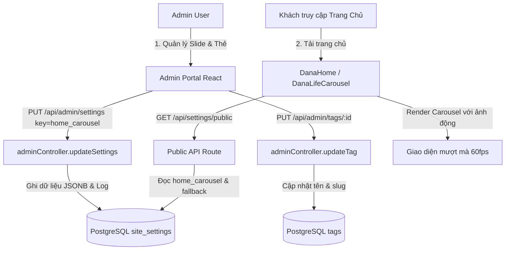

# Implementation Plan: Admin Dynamic CMS — Homepage Carousel, Full Tags Management & Site Customization

> **Status**: `COMPLETED`  
> **Author**: Senior Full-Stack Engineer / Software Architect  
> **Target Date / Sprint**: November 2026 / Sprint CMS Evolution  
> **Risk Level**: `MEDIUM` (Full-stack enhancements, non-breaking, backwards-compatible with static fallbacks)
> **Verified**: November 9, 2026 (TypeScript Build Clean, ESLint Clean on modified files, Node.js syntax verified)

---

## 1. Objective
Cung cấp quyền quản trị toàn diện cho Quản trị viên (Admin) trên hệ thống ChampaWeb:
1. **Dynamic Homepage Carousel**: Chuyển đổi toàn bộ slide ảnh đầu trang chủ từ dạng fix cứng (hardcoded) sang quản trị động trong CMS (thêm, sửa, đổi thứ tự, bật/tắt, nhúng ảnh từ Thư viện Media).
2. **Comprehensive Tag Management**: Nâng cấp hệ thống Thẻ (Tags) cho phép Admin tạo mới, chỉnh sửa tên/slug, xóa an toàn, và kết nối đồng bộ giữa các bài viết, tư liệu và sản phẩm.
3. **Public Settings & Site Customization API**: Cung cấp endpoint công khai để người dùng truy cập trang chủ tải cấu hình Carousel và thông tin trang một cách mượt mà, có fallback an toàn chống gián đoạn giao diện.

---

## 2. Scope & Non-Goals

### In Scope
- **Backend**:
  - Mở rộng dịch vụ `adminService`: Thêm `updateTag(id, data, actor)` để đổi tên thẻ và cập nhật lại slug.
  - Endpoint quản trị `PUT /api/admin/tags/:id` được bảo vệ bởi middleware xác thực và phân quyền (`requireRole(["admin", "editor"])`).
  - Endpoint công khai `GET /api/settings/public`: Phục vụ dữ liệu Carousel trang chủ (`home_carousel`), thông tin liên hệ và SEO cơ bản cho khách vãng lai không cần đăng nhập.
  - Cập nhật nhật ký kiểm toán (`activity_logs`) khi Admin chỉnh sửa thẻ hoặc cập nhật carousel.
- **Frontend**:
  - **Quản lý Carousel Trang chủ (`AdminSettingsPage.tsx`)**:
    - Thêm Tab chuyên biệt: "Carousel Trang Chủ".
    - Danh sách các slide: Xem trước thumbnail, tiêu đề, mô tả phụ, đường dẫn liên kết, thứ tự (`order`), trạng thái kích hoạt (`isActive`).
    - Modal/Form thêm mới và chỉnh sửa slide, tích hợp chọn ảnh từ `MediaPickerModal` hoặc nhập URL trực tiếp.
    - Sắp xếp thứ tự hiển thị và xóa slide.
  - **Quản lý Thẻ chuyên sâu (`AdminCategoriesPage.tsx`)**:
    - Bổ sung nút "Chỉnh sửa" cho từng thẻ trong danh sách.
    - Modal cập nhật tên thẻ và cập nhật tức thì vào danh sách hiển thị.
  - **Trang chủ Khách hàng (`DanaLifeCarousel.tsx`)**:
    - Nạp danh sách slide động từ `GET /api/settings/public`.
    - Lọc các slide có `isActive: true` và sắp xếp theo `order`.
    - Fallback an toàn: Nếu API gặp sự cố hoặc chưa có slide nào, tự động sử dụng danh sách slide mặc định nguyên bản.

### Non-Goals (Out of Scope)
- Không can thiệp hoặc thay đổi cấu trúc bảng authentication (`profiles`, `users`).
- Không thực hiện thao tác DROP bảng gây mất mát dữ liệu hiện hữu.
- Không làm thay đổi giao diện trình diễn mượt mà của thanh tiến trình tự động chạy slide trên `DanaLifeCarousel`.

---

## 3. Requirements & Acceptance Criteria

- [ ] **AC 1 (Dynamic Carousel API)**:
  - *Given* một người dùng truy cập trang chủ,
  - *When* trang tải `DanaLifeCarousel.tsx`,
  - *Then* hệ thống gửi yêu cầu `GET /api/settings/public`, hiển thị các slide đã được Admin cấu hình theo đúng thứ tự. Nếu không có dữ liệu hoặc lỗi mạng, tự động hiển thị 5 slide mặc định ban đầu mà không gây giật lag.
- [ ] **AC 2 (Admin Carousel Management)**:
  - *Given* Admin đăng nhập vào `/admin/settings`,
  - *When* Admin chuyển sang Tab "Carousel Trang Chủ",
  - *Then* Admin thấy toàn bộ danh sách slide, có thể Thêm slide mới (chọn ảnh từ Thư viện Media), Sửa tiêu đề/ảnh/liên kết, Thay đổi trạng thái Ẩn/Hiện, và Xóa slide. Sau khi bấm Lưu, dữ liệu được đồng bộ vào `site_settings`.
- [ ] **AC 3 (Admin Tag Update)**:
  - *Given* Admin hoặc Editor tại trang `/admin/categories` (Tab "Từ khóa & Thẻ"),
  - *When* Admin nhấn nút "Chỉnh sửa" một thẻ và đổi tên thành tên mới,
  - *Then* hệ thống gọi `PUT /api/admin/tags/:id`, tự động cập nhật tên, chuẩn hóa slug mới, cập nhật số liệu bài viết liên kết, ghi nhận Activity Log và thông báo Toast thành công.
- [ ] **AC 4 (Tag Name Validation & Idempotency)**:
  - *Given* Admin sửa một thẻ thành tên bị trùng lặp với một thẻ khác đang tồn tại,
  - *Then* hệ thống trả về lỗi 400 rõ ràng và không làm hỏng dữ liệu liên kết cũ.

---

## 4. Technical Approach

### Architecture & Data Flow



### Data Schema (site_settings: home_carousel)
Dữ liệu lưu trữ trong bảng `site_settings` với key `"home_carousel"`:
```json
[
  {
    "id": 1,
    "title": "Tháp Cổ Po Klong Garai - Đỉnh Cao Nghệ Thuật Champa",
    "subtitle": "Kalan ngàn năm trên đồi Trầu - Đô thành Panduranga",
    "image": "https://lh3.googleusercontent.com/...",
    "link": "/kham-pha/thap-po-klong-garai",
    "order": 1,
    "isActive": true
  }
]
```

---

## 5. Affected Files & Modules

### Backend
1. `backend/src/services/adminService.js`:
   - Thêm phương thức `updateTag(id, data, actor)`
   - Cung cấp phương thức `getPublicSettings()` trả về `{ site_info, seo_defaults, social_links, home_carousel }`
2. `backend/src/controllers/adminController.js`:
   - Thêm phương thức `updateTag(req, res, next)`
   - Thêm phương thức `getPublicSettings(req, res, next)`
3. `backend/src/routes/adminRoutes.js`:
   - Khai báo route `PUT /tags/:id`
4. `backend/src/routes/index.js` (hoặc public route):
   - Mount endpoint công khai `GET /api/settings/public`

### Frontend
1. `frontend/src/pages/admin/AdminSettingsPage.tsx`:
   - Bổ sung Tab "Carousel Trang Chủ"
   - Giao diện danh sách slide, Modal thêm/sửa slide, tích hợp `MediaPickerModal`
2. `frontend/src/pages/admin/AdminCategoriesPage.tsx`:
   - Bổ sung chức năng Modal sửa thẻ Tag (`handleEditTag`, form sửa tên)
3. `frontend/src/components/DanaLifeCarousel.tsx`:
   - Nạp dữ liệu từ `/api/settings/public` với `useState` và `useEffect`
   - Giữ nguyên toàn bộ logic chuyển slide mượt, lightbox phóng to, thanh chạy tiến trình
4. `frontend/src/types/index.ts` (hoặc type cục bộ):
   - Định nghĩa interface `CarouselSlide`

---

## 6. Implementation Tasks Checklist

- [x] **Task 1 (Backend - Tag Update)**:
  - Triển khai `updateTag` trong `adminService.js` và `adminController.js`.
  - Khai báo tuyến đường `PUT /api/admin/tags/:id` trong `adminRoutes.js`.
- [x] **Task 2 (Backend - Public Settings & Carousel)**:
  - Cung cấp `getPublicSettings` lấy cấu hình carousel và thông tin trang công khai.
  - Mount route `GET /api/settings/public` không yêu cầu token đăng nhập.
- [x] **Task 3 (Frontend - Carousel CMS in AdminSettingsPage)**:
  - Thêm tab Carousel, xây dựng giao diện thêm/sửa/xóa/đổi thứ tự slide.
  - Tích hợp chọn ảnh từ thư viện Media (`MediaPickerModal`).
- [x] **Task 4 (Frontend - Edit Tag Modal in AdminCategoriesPage)**:
  - Bổ sung giao diện và modal sửa thẻ, gọi API `PUT /api/admin/tags/:id`.
- [x] **Task 5 (Frontend - Dynamic DanaLifeCarousel)**:
  - Kết nối component `DanaLifeCarousel.tsx` vào API công khai với cơ chế fallback dự phòng 100%.
- [x] **Task 6 (Verification & Quality Gates)**:
  - Chạy `npm run build --prefix frontend` (TypeScript & Vite build thành công 100%).
  - Kiểm tra cú pháp toàn bộ file backend với `node -c` (Passed).
  - Linting file chỉnh sửa với ESLint (0 errors, 0 warnings).

---

## 7. Test Strategy & Verification

1. **Backend Validation**:
   - Chạy `node -c` xác nhận toàn bộ cú pháp controllers, routes, services không có lỗi cú pháp.
2. **Frontend Type Checking & Build**:
   - Chạy `npm run build --prefix frontend` đảm bảo 100% module biên dịch thành công, không lỗi TypeScript.
3. **End-to-End Scenario Testing**:
   - Đăng nhập quyền Admin -> Vào Cài đặt -> Thêm slide mới -> Kiểm tra Trang chủ hiển thị slide mới ngay lập tức.
   - Sửa 1 Thẻ bất kỳ -> Kiểm tra tên thẻ cập nhật chuẩn xác trong danh sách và bài viết liên kết.

---

## 8. Risks, Dependencies & Mitigations

| Nguy cơ (Risk) | Mức độ | Biện pháp giảm thiểu (Mitigation Strategy) |
|---|---|---|
| Mất kết nối DB hoặc chưa có slide nào được tạo trong CMS | Thấp | Trang chủ luôn giữ sẵn fallback 5 slide mặc định nguyên bản, đảm bảo web luôn hiển thị đẹp dù DB trống. |
| Người dùng nhập trùng tên thẻ khi sửa | Thấp | Backend kiểm tra trùng lặp và báo lỗi cụ thể, không ghi đè dữ liệu. |
| Kích thước ảnh slide quá lớn gây tải chậm | Trung bình | Tích hợp thư viện Media đã nén và hỗ trợ ảnh tối ưu từ Supabase/Google storage. |

